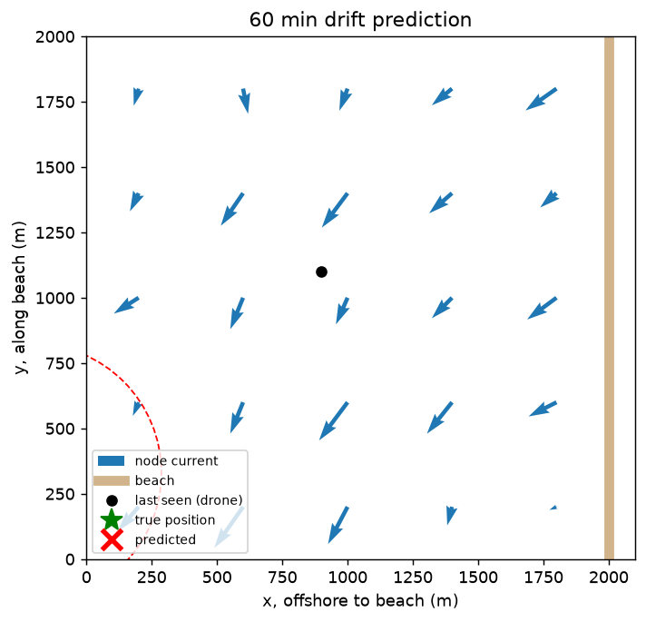
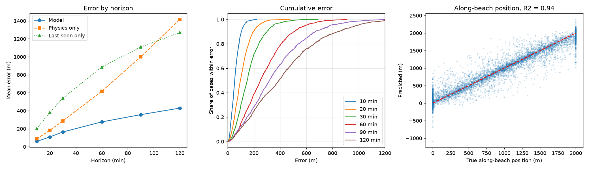

# SeaYou Drift Prediction Model

A machine learning model that predicts where a person in the water will end up after a given time, so rescuers
know where to search. It is the prediction component of **SeaYou**, a project that combines a drone, which gives the
last seen position, with a grid of in-water sensor nodes that measure current speed and direction.

**Input:** last seen GPS position, the latest node readings (plus readings from 15 minutes earlier), optional wind, and a time horizon.
**Output:** predicted GPS position, a 90% search radius, and the probability the person reaches the beach.



## Highlights

- **Hybrid physics and ML model.** Interpolated node currents give a physical baseline, and gradient boosting learns what the baseline misses (wind drift, eddies, rip currents, shoreline effects).
- **Calibrated uncertainty.** A split conformal search radius is computed per horizon, so rescuers get an area to search and not just a single point.
- **Realistic synthetic data pipeline.** A physics simulator generates labelled drift scenarios with sensor noise, GPS error and hidden per-body wind drift.
- **Honest evaluation.** Train and test sets are split by scenario, so the test set contains ocean conditions the model has never seen.
- **Simple GPS in, GPS out API** that handles dead nodes and flags unreliable inputs.

## Results

Evaluated on 200 unseen scenarios (7,200 predictions) of simulated data. Error is the straight-line distance between predicted and true position.

| Method | Mean error | Median | 90th percentile |
|---|---|---|---|
| Last seen position (no drift) | 732 m | 565 m | 1550 m |
| Physics only (interpolated current) | 598 m | 340 m | 1512 m |
| **This model** | **232 m** | **157 m** | **539 m** |

| Horizon | Model mean error | Within 250 m | Physics only |
|---|---|---|---|
| 10 min | 59 m | 100% | 87 m |
| 20 min | 109 m | 97% | 182 m |
| 30 min | 165 m | 81% | 287 m |
| 60 min | 277 m | 49% | 617 m |
| 90 min | 357 m | 38% | 1001 m |
| 120 min | 428 m | 32% | 1416 m |

- R2 of the final position: 0.88 across the beach, 0.94 along it.
- The 90% search radius contained the true position in 88% of cases.
- Beach prediction: 67% recall and 70% precision. Only about 7% of cases reach the beach, so plain accuracy would be misleading.



Exact numbers can vary slightly with library versions. Run `evaluate.py` to reproduce them.

## Quick start

Requires Python 3.10 or newer.

```powershell
git clone https://github.com/Rivan-Maritz/seayou-drift-model.git
cd seayou-drift-model
py -m venv .venv
.venv\Scripts\Activate.ps1
py -m pip install -r requirements.txt

py generate_data.py --scenarios 1000 --bodies 6 --out data   # writes data/train.csv and data/test.csv
py train_model.py                                            # trains and writes model/
py evaluate.py                                               # accuracy table and evaluation.png
py drift_api.py                                              # end to end GPS in, GPS out demo
```

On macOS or Linux use `python3` instead of `py` and `source .venv/bin/activate` to activate the environment.

## Usage

```python
from drift_api import GeoFrame, predict_drift

# Ties GPS to the model's local grid
frame = GeoFrame(origin_lat=-29.85, origin_lon=31.05, onshore_bearing_deg=270)

result = predict_drift(
    frame,
    last_seen_lat=-29.855, last_seen_lon=31.04,
    node_readings=[{"node_id": 0, "speed_ms": 0.31, "direction_deg": 95}, ...],
    prev_node_readings=[...],          # same format, about 15 minutes earlier
    wind_speed_ms=6, wind_from_deg=225,
    horizon_min=60,
)
```

Example result:

```json
{
  "latitude": -29.8555,
  "longitude": 31.0502,
  "horizon_min": 60,
  "search_radius_m": 494,
  "reaches_beach": false,
  "beach_probability": 0.0001,
  "drift_distance_m": 1046,
  "drift_bearing_deg": 62,
  "warnings": []
}
```

Conventions:

- Node `direction_deg` is the compass bearing the water flows **towards**. Wind direction is the bearing it blows **from**.
- `GeoFrame` takes the open-water corner of the node grid and the compass bearing from open water straight towards the beach.
- Nodes are numbered 0 to 24. `node_layout_latlon(frame)` returns where each node must be placed.
- Dead or missing nodes are interpolated from the working ones (at least 3 are required).
- `predict_drift_track(...)` returns predictions at every trained horizon (10, 20, 30, 60, 90 and 120 minutes) for drawing a drift path.
- Warnings are returned when the position is outside the node grid, the horizon is outside the trained range, or wind or earlier readings were not supplied.

## How it works

1. **Simulation** (`simulator.py`): each scenario is a random ocean state with a mean longshore and cross-shore current, divergence-free eddies, an optional rip current, slow tide and weather variation, and a wind-driven surface current. Bodies are advected with RK2 integration plus random-walk turbulence, with a hidden per-body leeway the nodes cannot see. They stop when they reach the shore.
2. **Observations**: nodes read the true current plus 0.02 m/s noise, the drone position carries 5 m of GPS error, and wind has 0.5 m/s of error.
3. **Features** (`seayou_common.py`): 25 node currents, their 15 minute trends, the interpolated current at the last seen point, wind, horizon, distance to shore, and a physics baseline displacement.
4. **Model** (`train_model.py`): gradient boosting regressors predict the residual between true displacement and the physics baseline. A separate classifier predicts beaching and snaps the position to the shoreline when it fires.
5. **Uncertainty**: split conformal calibration on held-out scenarios gives a 90% search radius per horizon.

## Project structure

```
seayou-drift-model/
  seayou_common.py   Shared constants, node layout, feature engineering
  simulator.py       Physics simulator that produces ground truth drift
  generate_data.py   Builds data/train.csv and data/test.csv
  train_model.py     Trains the model, calibrates the search radius, writes metrics
  evaluate.py        Accuracy table and evaluation.png
  predict.py         Local x/y prediction function and demo
  drift_api.py       GPS in, GPS out interface
  model/metrics.json Metrics from the last training run
  demo.png           Example prediction
  evaluation.png     Evaluation charts
```

## Limitations

- **All results come from simulated data.** The model has not been validated against real drifter or GPS buoy tracks, and real performance depends on how closely the simulator matches a given site.
- The node layout is fixed (5 by 5 grid, 400 m spacing, straight beach, 2 km by 2 km area). A different deployment needs a layout change in `seayou_common.py` and retraining.
- Waves, bathymetry, water temperature and body characteristics beyond a random wind drift factor are not modelled.
- This is a decision aid for human searchers and must not be the sole basis for a search.

## Roadmap

- Fine-tune on real drifter data collected at a test beach
- Compare against established search and rescue leeway drift models
- Support irregular node layouts and curved coastlines
- Predict full drift paths with a probability map instead of a single point and radius
- Serve the model behind a small HTTP API

## Author

Built by [Rivan-Maritz](https://github.com/Rivan-Maritz).